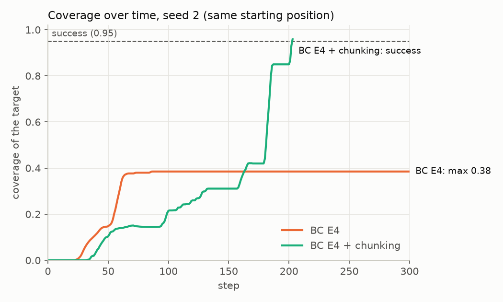
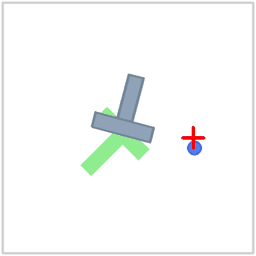

# pusht-bc

Behavior cloning on [Push-T](https://github.com/huggingface/gym-pusht), from 0% to 9.5% success, next to the pretrained
Diffusion Policy at 60%. Every policy here learns from the same 206 human demonstrations of
[`lerobot/pusht`](https://huggingface.co/datasets/lerobot/pusht) and is evaluated closed loop in simulation on the same
200 fresh seeds, through the same evaluation loop.

| Same start (seed 2), BC without chunking: stalls at 38% | With action chunking: success at step 203 |
| --- | --- |
|  |  |

## Results

<!-- BEGIN:final-table -->
| Policy | Seeds | Success | 95% CI | Avg max coverage |
| --- | --- | --- | --- | --- |
| Pretrained Diffusion Policy (`lerobot/diffusion_pusht`) | 1000–1199 (n=200) | 60.0% | 53.1%–66.5% | 0.896 |
| BC v0: frozen ResNet-18 features + MLP | 1000–1199 (n=200) | 0.0% | 0.0%–1.9% | 0.099 |
| BC E4: ResNet-18 trained end to end, 84×84 crops | 1000–1199 (n=200) | 0.0% | 0.0%–1.9% | 0.258 |
| BC E7: E4 + action chunking (8 predicted, 4 executed) | 1000–1199 (n=200) | 9.5% | 6.2%–14.4% | 0.551 |
<!-- END:final-table -->

Success = the T covers at least 95% of the target at some step within 300 steps (95% Wilson intervals). Full analysis
in [REPORT.md](REPORT.md).

## From 0% to 9.5%

| Step | Change | Success | Avg max coverage | Why it helped |
| --- | --- | --- | --- | --- |
| v0 | frozen ImageNet ResNet-18 features + MLP, one action per step | 0% | 0.099 | - |
| E4 | train the ResNet-18 end to end on Push-T images | 0% | 0.258 | frozen ImageNet features barely encode the T's pose |
| E7 | predict 8 actions, execute 4, then predict again | **9.5%** | **0.551** | commits to short plans instead of re-deciding (and stalling) every frame |

What didn't help: more data with frozen features (E3), and lower validation loss (E2: it fell 22% while coverage stayed
flat, because offline loss only sees states the expert visited, not the ones the policy drives itself into).



Each step in the green curve is a new chunk: the policy keeps working the T in short committed pushes, while the
single-step policy makes one push and parks. (This episode is a CPU replay; the reported numbers come from the GPU runs.)

## How BC fails

Most failed episodes end with the pusher parked: after good progress (stall), after pushing the T the wrong way (drift),
or just short of the target (near miss). The policy sees one frame and has no memory, and MSE averages demonstrations
that go different ways into a small, hesitant action.

| Diffusion Policy, seed 0: success | BC, seed 0: same start, stalls at 74% |
| --- | --- |
|  |  |
| **BC, seed 3: near miss, 94.4%** | **BC, seed 1: pushes the T away, 0%** |
|  |  |

BC examples are E4 (no chunking). BC GIFs play at 2× speed.

## What's still missing

The Diffusion Policy uses the same data and the same ResNet-18 on 84×84 crops. The 50-point gap comes from the policy:

- **Action chunking:** done here (E7), 0% → 9.5%.
- **Observation history:** 2+ frames, so the policy can tell which phase of the task it is in.
- **A multimodal action model** (diffusion, or ACT's latent variable): picks one way around the T instead of averaging
  them. With chunking alone, 69 of 200 episodes still end between 85% and 95% coverage.

## How it works

1. **Split by episode** (185 train / 21 validation), so validation frames never come from a training demonstration.
2. **Normalize** pusher state and actions to [-1, 1] with min-max stats; images with ImageNet stats. The same stats are
   saved in every checkpoint and reused at evaluation.
3. **Policy:** ResNet-18 image features (512) + pusher position → MLP (2 × 256) → next target position, or the next 8
   positions with chunking. v0 uses frozen, precomputed features; E4 and E7 train the ResNet end to end on random 84×84 crops.
4. **Loss:** MSE on normalized actions, i.e. maximum likelihood under a fixed-variance Gaussian policy. With chunking,
   targets past the end of an episode are masked out.
5. **Evaluation:** closed-loop rollouts in gym-pusht with fixed seeds, at most 300 steps, actions clipped to [0, 512].
   Success = maximum coverage ≥ 95%. Coverage comes from `info["coverage"]` (the env's reward is coverage / 0.95, capped at 1).

The core (split, normalization, model, loss, training and evaluation loops) was written by hand; data loading,
checkpointing and the CLIs were scaffolded with a coding agent.

## Install

Python 3.10–3.13 (developed on 3.12).

```bash
uv venv .venv --python 3.12
uv pip install -e ".[dev]"      # lerobot[pusht,diffusion]==0.7.0, torch, ...
```

`requirements.lock.txt` pins the exact versions of a working install (Windows, CPU torch). The first run downloads
`lerobot/pusht` and the pretrained Diffusion Policy from the Hugging Face Hub. LeRobot may warn that `torchcodec` can't
decode videos and fall back to `pyav`; that is harmless.

**Colab:** open `notebooks/01_experiments.ipynb` with a GPU runtime. The first cell clones this repo into
`/content/push-t` (or pulls it), the second installs it. Restart the session after the first install.

```bash
python scripts/check_env.py     # smoke test: one random episode, saves runs/check_env/random.mp4
pytest                          # unit tests (the first run downloads the dataset)
```

## Reproduce

```bash
# 1. Cache frozen ResNet-18 features of every frame (once, ~5 min on CPU)
python scripts/cache_features.py

# 2. Train (one checkpoint per epoch in runs/<name>/checkpoints/)
python -m pusht_bc.train --config configs/bc_v0.yaml            # v0: frozen features, minutes on CPU
python -m pusht_bc.train --config configs/e4_end_to_end.yaml    # E4: end-to-end encoder, use a GPU
python -m pusht_bc.train --config configs/e7_chunk_e4.yaml      # E7: E4 + action chunking, use a GPU

# 3. Evaluate closed loop on fixed seeds
python -m pusht_bc.evaluate --checkpoint runs/bc_v0/checkpoints/epoch_050.pt --seeds 0-49 --record 0,1,2
python -m pusht_bc.evaluate --checkpoint runs/e4_end_to_end/checkpoints/epoch_020.pt --seeds 1000-1199
python -m pusht_bc.evaluate --checkpoint runs/e7_chunk_e4/checkpoints/epoch_020.pt --seeds 1000-1199
python -m pusht_bc.evaluate --pretrained-dp --seeds 1000-1199                       # reference, use a GPU

# 4. Experiments and report
python scripts/run_e3.py                 # E3: train on 25% / 50% of the episodes and evaluate
python scripts/make_report_assets.py     # tables, plots and GIFs for REPORT.md and this README
```

Evaluation flags: `--seeds` (`0-49`, `1000-1199`, `0,3,7`), `--record` (seeds saved as video), `--max-steps`,
`--device`, `--out`. Seeds 0–49 were used while developing and 1000–1199 only for the final numbers.

## Configs

| Config | What changes |
| --- | --- |
| `configs/bc_v0.yaml` | baseline: cached frozen features, lr 1e-3, batch 256, 50 epochs |
| `configs/e3_frac25.yaml`, `e3_frac50.yaml` | v0 trained on 25% / 50% of the training episodes |
| `configs/e4_end_to_end.yaml` | ResNet-18 trained end to end, 84×84 crops, lr 1e-4, batch 64, 20 epochs |
| `configs/e7_chunk_v0.yaml` | v0 + action chunking (8 predicted, 4 executed), CPU check |
| `configs/e7_chunk_e4.yaml` | E4 + action chunking (8 predicted, 4 executed) |

Unknown keys are rejected. Relative paths resolve against the repo root, so scripts and notebooks run from any folder.

## Outputs

```
data/cache/features_resnet18.pt          feature cache (gitignored)
runs/<name>/checkpoints/epoch_XXX.pt     head weights + normalizer stats + config (+ encoder if trained)
runs/<name>/history.json, losses.png     loss history and curves
runs/<name>/eval/<folder>/               summary.json (per-seed coverage curves), seed_<s>.mp4, coverage.png
docs/media/                              plots and GIFs used by REPORT.md and this README
```

## Layout

```
configs/        experiment configs
src/pusht_bc/   data, normalization, model, loss, training, evaluation, pretrained Diffusion Policy adapter
scripts/        feature cache, smoke test, E3 runner, report assets
notebooks/      00_explore_data (dataset exploration), 01_experiments (training, evaluation, plots)
tests/          unit tests, with a fake env for the evaluation loop
```
