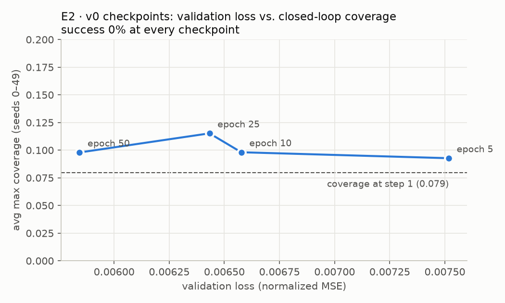
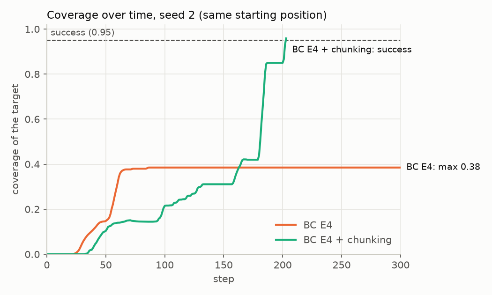
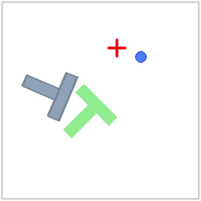
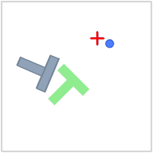
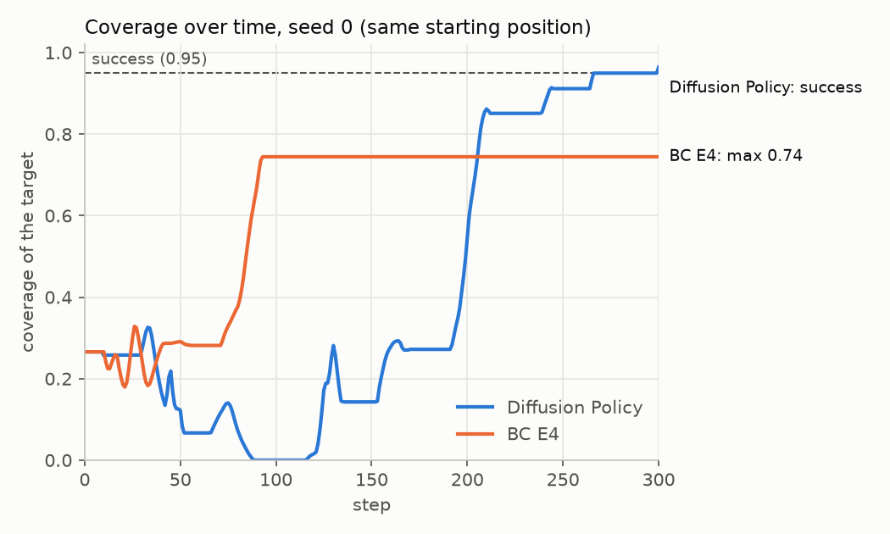
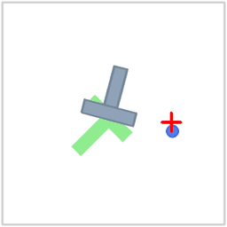
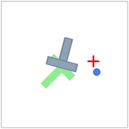
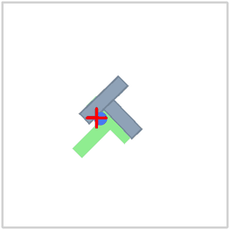

# Behavior cloning on Push-T: report

Single-frame behavior cloning on Push-T, with and without action chunking, compared with the pretrained Diffusion Policy
through the same evaluation loop.
Data: `lerobot/pusht`, 206 human demonstrations (25,650 frames), split by episode into 185 train / 21 validation.
Evaluation: gym-pusht, at most 300 steps, success = maximum coverage of the target ≥ 95% during the episode,
95% Wilson intervals. Seeds 0–49 for development, 200 fresh seeds (1000–1199) for the final numbers.

## 1 · Results

<!-- BEGIN:final-table -->
| Policy | Seeds | Success | 95% CI | Avg max coverage |
| --- | --- | --- | --- | --- |
| Pretrained Diffusion Policy (`lerobot/diffusion_pusht`) | 1000–1199 (n=200) | 60.0% | 53.1%–66.5% | 0.896 |
| BC v0: frozen ResNet-18 features + MLP | 1000–1199 (n=200) | 0.0% | 0.0%–1.9% | 0.099 |
| BC E4: ResNet-18 trained end to end, 84×84 crops | 1000–1199 (n=200) | 0.0% | 0.0%–1.9% | 0.258 |
| BC E7: E4 + action chunking (8 predicted, 4 executed) | 1000–1199 (n=200) | 9.5% | 6.2%–14.4% | 0.551 |
<!-- END:final-table -->

- **v0** = frozen ImageNet ResNet-18 features (512) + pusher position → MLP → next target position, MSE on normalized actions.
- **E4** = the same policy with ResNet-18 trained end to end on random 84×84 crops (center crop at evaluation), lr 1e-4, 20 epochs.
- **E7** = E4 predicting the next 8 actions at once and executing 4 before predicting again; everything else identical.
- The Diffusion Policy samples noise at every action prediction and that noise is not tied to the env seed, so its rows
  vary by a few episodes between runs on the same seeds (58% and 66% on two runs of seeds 0–49).

Single-step behavior cloning never solves the task, while the Diffusion Policy solves 60% of the same starting
positions. The gap is not data or the image encoder: the Diffusion Policy was trained on the same 206 demonstrations and
also uses a ResNet-18 on 84×84 crops. What differs is the policy: it commits to chunks of actions instead of deciding
every step, it sees the last 2 frames instead of 1, and it models the full distribution of expert actions (diffusion)
instead of their mean (MSE).

Each step of this project closes part of that gap. Training the encoder on Push-T images (E4) gives 2.6× the coverage of
frozen ImageNet features (v0), which don't encode the T's pose well enough; more data with the same features did not
help (E3). Adding action chunking on top (E7) gives the first successes, 9.5% (95% CI 6.2–14.4%), and doubles coverage
again. The remaining gap to 60% is what history and a multimodal action distribution would have to close.

### Development runs (seeds 0–49, last checkpoint)

<!-- BEGIN:dev-table -->
| Run | Best val loss | Success | Avg max coverage |
| --- | --- | --- | --- |
| Pretrained Diffusion Policy | - | 58% | 0.909 |
| v0 (100% of train episodes) | 0.00557 | 0% | 0.098 |
| E3: 50% of train episodes | 0.00665 | 0% | 0.123 |
| E3: 25% of train episodes | 0.00954 | 0% | 0.110 |
| E4: end-to-end encoder | 0.00418 | 0% | 0.290 |
| E7: v0 + action chunking | 0.02162 | 0% | 0.221 |
| E7: E4 + action chunking | 0.01550 | 12% | 0.643 |
<!-- END:dev-table -->

Average coverage at the first step, before the policy has done anything, is about 0.08: coverage above that is what the
policy added. The E7 validation losses average the error over 8 future actions, so they are not comparable with the
single-action runs.

## 2 · Validation loss vs. closed-loop performance (E2)

Validation loss fell by 22% from epoch 5 to epoch 50 while closed-loop coverage stayed within a few points of doing
nothing: offline loss only measures error on states the expert visited, not on the states the policy drives itself
into, so it doesn't predict closed-loop performance. (The model also overfits, with train loss 0.0015 vs. validation
0.0058, but that alone doesn't explain the gap.)

## 3 · Action chunking (E7)

The policy predicts the next 8 actions at once and executes 4 before predicting again, instead of deciding every step.
Everything else is unchanged; padded targets past the end of an episode are masked out of the loss.

| Run | Success (seeds 0–49) | Avg max coverage | Episodes gaining > 5 points of coverage |
| --- | --- | --- | --- |
| v0 | 0% | 0.098 | 6 / 50 |
| v0 + chunking | 0% | 0.221 | 21 / 50 |
| E4 | 0% | 0.290 | 23 / 50 |
| E4 + chunking | 12% | 0.643 | 39 / 50 |

Chunking helps both encoders. With the frozen features it more than doubles v0's coverage (best episode 0.845); with
the trained encoder it turns E4's near misses into the first successes: 6 of 50 on seeds 0–49 and 19 of 200 on the
final seeds (9.5%). Committing to a short plan means 4× fewer decisions per episode and no re-averaging every frame,
which directly targets the stalls in the failure analysis below. It doesn't fix the averaging itself: on the final
seeds 69 of 200 episodes still end between 85% and 95% coverage, and 38 never move the T onto the target.

### Same start, with and without chunking

| E4, seed 2: stalls at 38% (2× speed) | E4 + chunking, seed 2: success at step 203 (2× speed) |
| --- | --- |
|  |  |

E4 makes one push to 38% and stops for good. With chunking the policy keeps working the T in short committed pushes,
each step of the curve a new chunk, until it crosses 95%. This episode is a CPU replay of the E7 checkpoint
(`runs/e7_chunk_e4/eval/cpu_replay_0_49`, 20% success on seeds 0–49 vs. 12% on the GPU run; see the notes on devices).

## 4 · Failure analysis

Ten failed episodes of E4 (seeds 0–9), each labeled with one failure mode:

| Failure mode | What you see | Likely cause |
| --- | --- | --- |
| Hesitation | the pusher wavers between sides of the block, or stops between them | averaging of multimodal demonstrations |
| Drift | a good start, then one bad push and no recovery | compounding errors, states missing from the data |
| Stall | the pusher stops moving mid-task | a single frame can't show the task's phase |
| Near miss | coverage reaches 85–94% but the final alignment fails | few demonstrations of fine corrections |
| Never reaches the block | aimless motion from the first step | the policy ignores the block |

Prediction before watching: similar to the v0 videos. No episode completes, either because the pusher stops or because
time runs out. Some get "close" (around 60–70% coverage), others stay at 0% because the pusher moves erratically.

<!-- BEGIN:failure-table -->
| Seed | Start coverage | Max coverage | Failure mode | What happens |
| --- | --- | --- | --- | --- |
| 0 | 0.266 | 0.744 | Stall | pushes the T smoothly into the target area, then stops as if it were done |
| 1 | 0.000 | 0.000 | Drift | pushes the T the wrong way, into the top wall, and never recovers |
| 2 | 0.000 | 0.385 | Stall | good start, then stops with about 40% of the T inside the target |
| 3 | 0.001 | 0.944 | Near miss | gets the T almost in place (94.4%), then stays still without the final correction |
| 4 | 0.000 | 0.000 | Stall | pushes the T toward the target, then leaves it next to the target without overlap |
| 5 | 0.000 | 0.398 | Drift | starts placing the T, then pushes it away from the target |
| 6 | 0.279 | 0.290 | Drift | easy start with the T already partly on the target, then pushes it away |
| 7 | 0.000 | 0.000 | Never reaches the block | the pusher goes to the bottom edge and stays there; the T is never touched |
| 8 | 0.000 | 0.000 | Drift | moves the T around, away from the target, then parks in a corner |
| 9 | 0.000 | 0.000 | Stall | lines up to push from the top and moves the T next to the target, then gets stuck without overlap |
<!-- END:failure-table -->

**Counts:** stall 4 · drift 4 · near miss 1 · never reaches the block 1 · hesitation 0

Almost every episode ends with the pusher parked, whether after good progress (stall) or after pushing the T the wrong
way (drift). The policy sees one frame and has no memory, so it can't tell which phase of the task it is in, and MSE
averages demonstrations that go different ways into a small, hesitant action. Near the T, "stay where you are" becomes
a fixed point it never leaves.

### Success vs. failure on the same starting position

| Diffusion Policy, seed 0: success | E4, seed 0: failure (2× speed) |
| --- | --- |
|  |  |

E4 makes one good push (0.27 → 0.74 by step 94) and then never touches the T again. The Diffusion Policy is worse
early on, even losing all coverage around step 90, but keeps re-approaching the T and correcting it until it succeeds.
Recovering from a bad state is exactly what a single-frame, mean-predicting policy can't do.

### Two explained failures

| E4, seed 2: stall (2× speed) | E4, seed 6: drift (2× speed) |
| --- | --- |
|  |  |
| Starts well, then stops with about 40% of the T on the target and never moves again. | Starts with the T already partly on the target, then pushes it away and doesn't recover. |

The failure analysis uses E4, before chunking; E7's successes are shown in section 3.

## 5 · What I'd change

- **Keep changing the policy, not the encoder:** chunking (E7) already took success from 0% to 9.5%. The next steps
  are observation history (2+ frames, so the policy can see where it is in the task) and a multimodal action model
  (ACT's latent variable or diffusion), which stop the averaging that still leaves 69 of 200 episodes just short.
- **More demonstrations, especially recoveries:** the policy fails in states the expert rarely visited. E3 shows more of
  the same data doesn't help frozen features, so the data would need to cover more states.
- **Not longer training:** E4's validation loss plateaus around 0.0042–0.0045 from epoch 7, and E2 shows lower
  validation loss doesn't translate into closed-loop success.

## Notes

- A bug found on the way: gym-pusht 0.1.8 returns `reward = clip(coverage / 0.95, 0, 1)`, not the coverage. Reading the
  reward as coverage counted near misses (coverage ≥ 0.9025) as successes and put the Diffusion Policy at 84%.
  The evaluation loop now reads `info["coverage"]`. All numbers above come from the fixed loop.
- BC evaluation is deterministic on one device but not across devices: tiny floating-point differences between GPU
  and CPU grow over 300 closed-loop steps. All reported numbers come from one device per run (Colab GPU for E4 and E7).
- Reproduce: `python -m pusht_bc.evaluate --checkpoint <run>/checkpoints/<epoch>.pt --seeds 1000-1199` and
  `python scripts/make_report_assets.py` to rebuild the tables and media.
